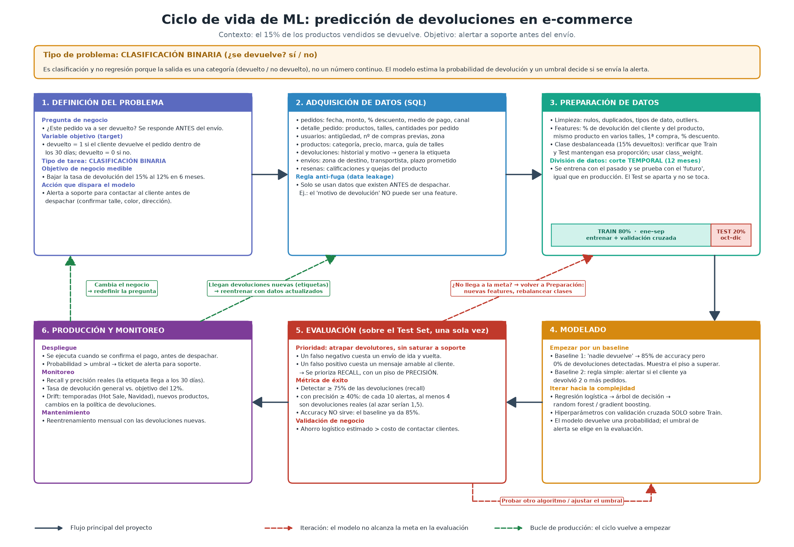

# Práctica 9: El ciclo de vida del Machine Learning (devoluciones en e-commerce)

Mapa del ciclo de vida de un proyecto de ML para un caso de negocio: una
tienda online donde el **15% de los productos vendidos se devuelve**, con
costos logísticos enormes. El sistema debe predecir si un pedido va a ser
devuelto, para que el equipo de soporte reciba una alerta **antes de
realizar el envío**.

Archivos:

- [`ciclo_vida_ml_devoluciones.png`](ciclo_vida_ml_devoluciones.png): el diagrama (entregable).
- [`ciclo_vida_ml_devoluciones.drawio`](ciclo_vida_ml_devoluciones.drawio): el mismo diagrama, editable en [draw.io / app.diagrams.net](https://app.diagrams.net) (*File → Open from → Device*).
- [`generar_diagrama.py`](generar_diagrama.py): genera los dos archivos anteriores a partir de una única definición de etapas y flechas (`python generar_diagrama.py`, requiere `matplotlib`). El ejercicio no lleva código de ML; el script solo dibuja el diagrama.

## Tipo de problema: clasificación binaria

La pregunta es *"¿este pedido va a ser devuelto?"*, así que la respuesta es
una **categoría** (devuelto / no devuelto) y no un número continuo. Por eso
es **clasificación** y no regresión.

El modelo estima la *probabilidad* de devolución, y un umbral decide si se
genera la alerta. Sería regresión si la pregunta fuera, por ejemplo, *"¿cuánto
dinero en devoluciones vamos a tener el mes que viene?"*.

## Las 6 etapas aplicadas al caso

### 1. Definición del problema

- **Pregunta:** ¿este pedido va a ser devuelto? Se responde antes del envío.
- **Variable objetivo:** `devuelto = 1` si el cliente devuelve el pedido
  dentro de los 30 días, `0` si no.
- **Objetivo de negocio medible:** bajar la tasa de devolución del 15% al
  12% en 6 meses.
- **Acción:** alerta a soporte para que contacte al cliente antes de
  despachar (confirmar talle, color, dirección).

### 2. Adquisición de datos: qué buscar en las tablas SQL

| Tabla | Qué aporta |
|---|---|
| `pedidos` | fecha, monto, % de descuento, medio de pago, canal |
| `detalle_pedido` | productos, talles y cantidades de cada pedido |
| `usuarios` | antigüedad, cantidad de compras previas, zona |
| `productos` | categoría, precio, marca, guía de talles |
| `devoluciones` | historial y motivo; de acá sale la **etiqueta** |
| `envios` | zona de destino, transportista, plazo prometido |
| `resenas` | calificaciones y quejas sobre el producto |

**Regla anti-fuga (data leakage):** solo se usan datos que existen *antes*
de despachar. Por ejemplo, el "motivo de devolución" sirve para construir la
etiqueta, pero nunca puede ser una feature: en el momento de predecir todavía
no existe.

### 3. Preparación de datos y división Train / Test

- **Limpieza:** nulos, duplicados, tipos de dato, outliers.
- **Features:** % de devolución histórico del cliente y del producto, mismo
  producto comprado en varios talles (señal clásica de "pruebo y devuelvo"),
  primera compra, % de descuento.
- **División temporal sobre 12 meses de pedidos:**
  - **Train (80%, enero a septiembre):** para entrenar y ajustar
    hiperparámetros con validación cruzada.
  - **Test (20%, octubre a diciembre):** se aparta al principio y no se toca
    hasta la evaluación final.

  Se corta por fecha y no al azar porque en producción el modelo siempre
  predice pedidos *futuros* con lo que aprendió del *pasado*. Un corte al azar
  mezclaría información futura en el entrenamiento y daría resultados
  demasiado optimistas.
- **Desbalance (solo 15% de positivos):** verificar que Train y Test
  mantengan esa proporción, y compensar con `class_weight` o rebalanceo.

### 4. Modelado: baseline primero, complejidad después

1. **Baseline 1, "nadie devuelve":** da 85% de accuracy pero detecta 0
   devoluciones. Marca el piso a superar y muestra por qué la accuracy
   engaña en este caso.
2. **Baseline 2, regla simple:** alertar si el cliente ya devolvió 2 o más
   pedidos.
3. **Iterar:** regresión logística → árbol de decisión → random forest /
   gradient boosting, con hiperparámetros ajustados por validación cruzada
   **solo sobre Train**.

### 5. Evaluación: ¿no molestar a clientes buenos o atrapar a todos los devolutores?

Se comparan los costos de cada error:

| Error | Qué pasa | Costo |
|---|---|---|
| **Falso negativo** (era devolución y no alertamos) | El pedido viaja, vuelve y hay que reacondicionarlo | **Alto**: envío de ida y vuelta + logística inversa |
| **Falso positivo** (alertamos a un cliente bueno) | Soporte le escribe para confirmar talle o dirección | **Bajo**: un mensaje amable, que incluso puede verse como buena atención |

**Decisión:** priorizar **atrapar a los potenciales devolutores (recall)**,
pero con un **piso de precisión**. El equipo de soporte tiene capacidad
limitada, y si la mayoría de las alertas son falsas se pierde la confianza en
el sistema y se termina molestando a clientes buenos.

**Métrica de éxito, medida una sola vez sobre el Test Set:**

> Detectar **al menos el 75% de las devoluciones** (recall ≥ 75%) con una
> **precisión de al menos 40%**: de cada 10 alertas, como mínimo 4 tienen
> que ser devoluciones reales. Alertando al azar serían 1,5 de cada 10.

No se usa *accuracy* como métrica porque el baseline trivial ya da 85% sin
detectar ninguna devolución. Además se valida en términos de negocio: el
ahorro logístico estimado (devoluciones evitadas × costo de una devolución)
tiene que superar el costo de contactar a los clientes alertados.

### 6. Producción y monitoreo

- **Despliegue:** el modelo se ejecuta al confirmarse el pago, antes de
  despachar. Si la probabilidad supera el umbral, se abre un ticket de
  alerta para soporte.
- **Monitoreo:** recall y precisión reales (la etiqueta llega recién a los
  30 días), tasa de devolución general frente al objetivo del 12%, y *drift*
  por temporadas (Hot Sale, Navidad), productos nuevos o cambios en la
  política de devoluciones.
- **Mantenimiento:** reentrenamiento mensual con las devoluciones nuevas.

## Los bucles: por qué no es una línea recta

| Flecha | Desde → hacia | Cuándo se recorre |
|---|---|---|
| 🔴 Iteración | Evaluación → **Preparación** | El modelo no llega a la meta: crear nuevas features, rebalancear clases, revisar la limpieza |
| 🔴 Iteración | Evaluación → **Modelado** | Probar otro algoritmo o ajustar el umbral de decisión |
| 🟢 Producción | Producción → **Adquisición** | Llegan devoluciones nuevas (nuevas etiquetas): reentrenar con datos actualizados |
| 🟢 Producción | Producción → **Definición** | Cambia el negocio (nueva política de devoluciones, nuevo objetivo): redefinir la pregunta |

Cada vez que se vuelve a Preparación o Modelado, se ajusta usando **solo
Train / validación cruzada**. El Test Set se reserva para la medición final;
si se usara para tomar decisiones dejaría de ser una estimación honesta del
rendimiento en producción.

## Checklist de la consigna

- [x] El diagrama incluye al menos 6 fases conectadas.
- [x] Se especifica claramente el tipo de tarea (**clasificación binaria**).
- [x] El diagrama muestra la división de datos (Train 80% / Test 20%, corte temporal).
- [x] Hay flechas de retroalimentación: 2 de iteración desde Evaluación y 2 de producción.
- [x] El contenido del diagrama no tiene código; se enfoca en la arquitectura del flujo.
- [x] La métrica es concreta y de negocio: recall ≥ 75% con precisión ≥ 40%, y no una "métrica" genérica.
